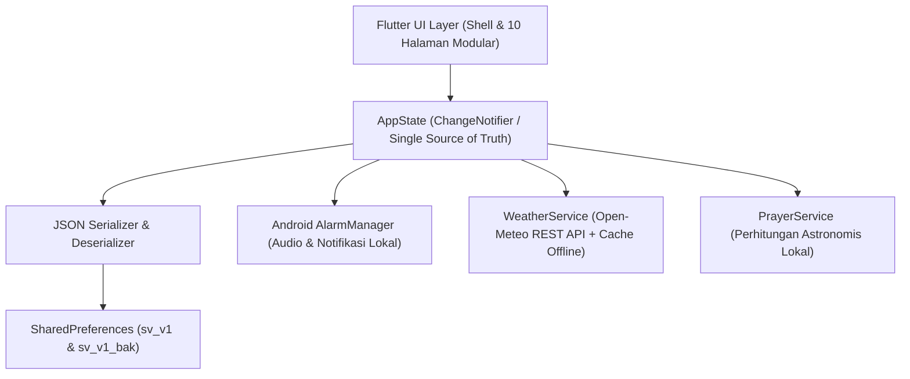

# SELF VOLTA: Sistem Manajemen Kehidupan Mandiri Anak Kos

[](https://flutter.dev)
[](#arsitektur-teknis)
[](test/)
[](https://github.com/voltakyy/self-volta/releases/tag/v1.3.1)
[](LICENSE)

> Aplikasi pendamping hidup mandiri berbasis Flutter yang dirancang spesifik untuk realitas hidup anak kos: anggaran kiriman bulanan yang ketat, keterbatasan alat masak kamar (panci listrik & rice cooker), siklus air galon 19L, latihan fisik tanpa alat di kamar sempit, serta sinkronisasi ritme harian (jadwal sholat, waktu belajar, dan perkiraan cuaca).

---

## Daftar Isi
1. [Manifesto & Latar Belakang Masalah](#1-manifesto--latar-belakang-masalah)
2. [Arsitektur Teknis & Prinsip Offline-First](#2-arsitektur-teknis--prinsip-offline-first)
3. [Modul Keuangan: Manajemen Kas & Limit Harian Dinamis](#3-modul-keuangan-manajemen-kas--limit-harian-dinamis)
4. [Buku Kas & Alokasi Target Impian (Piano Fund)](#4-buku-kas--alokasi-target-impian-piano-fund)
5. [Modul Planning Makanan: Filosofi Dapur 48:9 & Paket A–G](#5-modul-planning-makanan-filosofi-dapur-489--paket-ag)
6. [Eksekusi Resep: Panci Listrik ([PL]) & Magic Com ([MC])](#6-eksekusi-resep-panci-listrik-pl--magic-com-mc)
7. [Checklist Belanja Pasar & Manajemen Bahan Basah](#7-checklist-belanja-pasar--manajemen-bahan-basah)
8. [Modul Hidrasi: Siklus Galon 19L & Target Air Harian](#8-modul-hidrasi-siklus-galon-19l--target-air-harian)
9. [Modul Latihan Fisik: Calisthenics Kamar Kos Tanpa Alat](#9-modul-latihan-fisik-calisthenics-kamar-kos-tanpa-alat)
10. [Form Panduan Gerakan & Interval Pemulihan Otot](#10-form-panduan-gerakan--interval-pemulihan-otot)
11. [Modul Waktu & Sholat: Sinkronisasi Astronomis Lokal](#11-modul-waktu--sholat-sinkronisasi-astronomis-lokal)
12. [Modul Cuaca: Integrasi Open-Meteo & Indeks Jemuran Kos](#12-modul-cuaca-integrasi-open-meteo--indeks-jemuran-kos)
13. [Modul Study & Produktivitas: Siklus Fokus Pomodoro](#13-modul-study--produktivitas-siklus-fokus-pomodoro)
14. [Modul To-Do & Kebiasaan: Daily Discipline & XP Leveling](#14-modul-to-do--kebiasaan-daily-discipline--xp-leveling)
15. [Modul Booster: Recovery Nutrisi Murah & Pertolongan Pertama](#15-modul-booster-recovery-nutrisi-murah--pertolongan-pertama)
16. [Sistem Alarm & Notifikasi: Background Scheduler Offline](#16-sistem-alarm--notifikasi-background-scheduler-offline)
17. [Integritas Data: Fail-Safe Recovery & Cadangan sv_v1_bak](#17-integritas-data-fail-safe-recovery--cadangan-sv_v1_bak)
18. [Desain Visual Editorial: Tipografi Manrope & Bento Surface](#18-desain-visual-editorial-tipografi-manrope--bento-surface)
19. [Standar Pengujian: 313 Tes Otomatis & Audit Responsif](#19-standar-pengujian-313-tes-otomatis--audit-responsif)
20. [Panduan Instalasi, Build APK, & Kontribusi](#20-panduan-instalasi-build-apk--kontribusi)

---

## 1. Manifesto & Latar Belakang Masalah

Kehidupan anak kos di kota perantauan memiliki dinamika yang sangat spesifik dan jarang dijawab dengan tepat oleh aplikasi produktivitas umum:

- **Aplikasi budgeting konvensional** terlalu rumit dengan puluhan kategori akun bank, kartu kredit, dan investasi saham yang tidak relevan bagi mahasiswa atau perantau yang mengandalkan satu sumber uang saku bulanan.
- **Aplikasi resep kuliner umum** mengasumsikan ketersediaan dapur lengkap (kompor 2 tungku, oven, blender, kulkas 2 pintu), padahal anak kos hanya memiliki stopkontak 450-900 VA, satu panci listrik serbaguna, dan rice cooker kecil.
- **Aplikasi fitness komersial** menuntut langganan gym bulanan atau alat dumbbell, mengabaikan fakta bahwa ruang gerak kamar kos seringkali hanya berukuran 2×3 meter.
- **Aplikasi jadwal harian** menuntut koneksi internet terus-menerus dan pendaftaran akun berbasis email/password yang rentan pelacakan data, padahal sinyal di dalam kamar kos sering tidak stabil dan kuota internet seluler terbatas.

**SELF VOLTA** hadir sebagai solusi terpadu, 100% offline-first, tanpa iklan, dan tanpa tracking. Fokus utamanya adalah mempertahankan ritme hidup sehat, menjaga keuangan tetap aman hingga akhir bulan, dan memaksimalkan efisiensi energi seorang anak kos.

---

## 2. Arsitektur Teknis & Prinsip Offline-First

SELF VOLTA dibangun dengan prinsip kedaulatan data lokal (*local-first software*). Semua kalkulasi, penyimpanan catatan transaksi, checklist belanja, riwayat latihan, dan penjadwalan sholat dihitung langsung di perangkat (*on-device execution*).



### Karakteristik Arsitektur:
1. **Single Source of Truth (`AppState`)**: Seluruh state aplikasi diatur dalam satu objek `AppState` terpusat di [lib/store.dart](file:///C:/Users/Asus/self_volta/lib/store.dart). Setiap mutasi memicu `notifyListeners()` yang merefresh widget secara reaktif.
2. **Penyimpanan Dua Lapis (`sv_v1` & `sv_v1_bak`)**: Setiap kali `save()` dieksekusi, data aktif disimpan ke key `sv_v1`. Sebelum data baru menimpa, salinan data sebelumnya diamankan ke key `sv_v1_bak`. Jika terjadi force-close atau kegagalan penulisan disk, sistem otomatis melakukan pemulihan tanpa kehilangan catatan penting.
3. **Shell Navigasi Persisten (`lib/pages/shell.dart`)**: Menggunakan `IndexedStack` / page builder terintegrasi sehingga navigasi antar pilar (Beranda, Keuangan, Planning, Latihan, Profil) mempertahankan posisi scroll dan input form tanpa reload ulang.
4. **Independensi Jaringan**: Aplikasi tetap berfungsi 100% normal saat koneksi internet mati atau mode pesawat aktif. Koneksi data hanya dipakai secara opsional untuk menarik prakiraan cuaca Open-Meteo terkini.

---

## 3. Modul Keuangan: Manajemen Kas & Limit Harian Dinamis

Problem terbesar anak kos adalah jebakan awal bulan: merasa memiliki banyak uang saat kiriman baru masuk, namun kehabisan dana di minggu ketiga karena pengeluaran tidak terkendali.

Modul Keuangan [lib/pages/keuangan_page.dart](file:///C:/Users/Asus/self_volta/lib/pages/keuangan_page.dart) menerapkan pendekatan **Realtime Dynamic Limit Tracker**.

### Rumus Jatah Harian Dinamis:
Setiap kali ada transaksi yang dicatat atau tanggal berganti, sistem menghitung ulang batas aman belanja harian:

$$\text{Jatah Harian} = \begin{cases} 0, & \text{jika } \text{Sisa Budget} \le 0 \\ \left\lfloor \frac{\text{Sisa Budget}}{\text{Sisa Hari Bulan Berjalan}} \right\rfloor, & \text{jika } \text{Sisa Budget} > 0 \end{cases}$$

Dengan variabel perhitungan:
- $\text{Sisa Budget} = \text{Budget Bulanan} - \text{Total Pengeluaran Bulan Ini}$
- $\text{Sisa Hari} = (\text{Jumlah Hari Kalender Bulan Ini} - \text{Tanggal Hari Ini}) + 1$

### Contoh Kasus Riil:
1. **Tanggal 1 November** (30 hari): Budget Rp1.500.000.  
   $\text{Jatah Harian} = \frac{1.500.000}{30} = \text{Rp50.000 / hari}$.
2. **Tanggal 10 November** (tersisa 21 hari): Ternyata pengeluaran sudah mencapai Rp800.000 karena membeli perlengkapan kos. Sisa budget menjadi Rp700.000.  
   Sistem secara otomatis menurunkan limit harian secara transparan:  
   $\text{Jatah Harian} = \left\lfloor \frac{700.000}{21} \right\rfloor = \text{Rp33.333 / hari}$.
3. **Hasil untuk Pengguna**: Anak kos tidak perlu panik di akhir bulan. Indikator visual langsung memberitahukan nominal maksimal yang boleh dikeluarkan hari ini agar uang kas bertahan utuh sampai tanggal 30.

---

## 4. Buku Kas & Alokasi Target Impian (Piano Fund)

Pencatatan keuangan di SELF VOLTA tidak menuntut entri data yang melelahkan. Didesain dengan aksi cepat (*one-tap transaction modal*), anak kos dapat langsung mencatat transaksi setelah membayar makan warteg atau membeli sabun cuci.

### Struktur Transaksi (`Txn` di [lib/store.dart](file:///C:/Users/Asus/self_volta/lib/store.dart)):
```dart
class Txn {
  final String id;
  final String desc;   // Misal: "Makan siang warteg", "Isi ulang galon"
  final int amt;       // Nominal integer rupiah murni tanpa float
  final DateTime date;
  final bool isExpense;// true = pengeluaran, false = pemasukan tambahan
  final String tag;    // Kategori: Makan, Kos, Transport, Belajar, Lainnya
}
```

### Fitur Target Impian (Piano Fund):
Di samping biaya bertahan hidup, anak kos membutuhkan motivasi untuk menabung. SELF VOLTA mengintegrasikan kartu **Target Impian (Piano Fund)**:
- **Konsep**: Target tabungan khusus (seperti upgrade laptop tugas akhir, sertifikasi profesi, atau instrumen musik).
- **Mekanisme**: Setiap hari pengguna berhasil membelanjakan uang di bawah limit harian, surplus kas dapat disisihkan ke target tabungan impian (`PIANO_TARGET`).
- **Indikator**: Menampilkan visualisasi persentase capaian progresif, mengubah sisa uang belanja menjadi aset masa depan yang produktif.

---

## 5. Modul Planning Makanan: Filosofi Dapur 48:9 & Paket A–G

Makan di luar atau memesan makanan online setiap hari dapat menghabiskan Rp40.000 – Rp60.000 per hari, memicu krisis finansial di akhir bulan. Sebaliknya, makan mi instan setiap hari menurunkan daya tahan tubuh dan fokus belajar.

Modul Planning Makanan [lib/pages/planning_page.dart](file:///C:/Users/Asus/self_volta/lib/pages/planning_page.dart) dirancang dengan konsep **Dapur 48:9**:
- **48 (Siklus Bahan 48 Jam)**: Bahan basah (tahu, tempe, bayam, sawi, telur) dibeli dalam porsi kecil yang habis dikonsumsi dalam 48 jam sehingga tidak membutuhkan kulkas besar dan tidak membusuk di kamar kos.
- **9 (Sembilan Bumbu Dasar Kos)**: Bawang merah, bawang putih, garam, gula pasir, merica bubuk, kecap manis, saus tiram, minyak goreng, dan kaldu jamur. Bumbu ini dibeli satu kali di awal bulan sehingga biaya bumbu per porsi masak dihitung Rp0 (dari stok).

### Katalog 7 Paket Menu Mingguan (Paket A – G):

| Paket | Nama Menu & Komposisi | Estimasi Biaya | Kalori & Protein | Target Nutrisi |
| :--- | :--- | :--- | :--- | :--- |
| **A** | Telur + Tempe + Bening Bayam | Rp22.500 / hari | 650 kcal · 48g Protein | Massa Otot & Serat |
| **B** | Tahu + Telur + Sawi Putih | Rp21.000 / hari | 630 kcal · 58g Protein | Tinggi Protein Nabati & Hewani |
| **C** | Ayam Suwir + Tempe Orek + Buncis | Rp24.000 / hari | 710 kcal · 52g Protein | Stamina Padat Kuliah/Kerja |
| **D** | Telur Dadar + Tahu + Sayur Sop | Rp19.500 / hari | 590 kcal · 42g Protein | Pemulihan & Rehidrasi Hangat |
| **E** | Tongkol / Kembung + Tempe + Kangkung | Rp23.500 / hari | 680 kcal · 55g Protein | Omega-3 & Mineral Alami |
| **F** | Telur Mata Sapi + Tahu + Tumis Toge | Rp18.000 / hari | 560 kcal · 40g Protein | Ekstra Cepat (Di Bawah 10 Menit) |
| **G** | Bakso Sapi + Telur + Sayur Kuah | Rp22.000 / hari | 640 kcal · 45g Protein | Variasi Akhir Pekan Terukur |

---

## 6. Eksekusi Resep: Panci Listrik ([PL]) & Magic Com ([MC])

Kamar kos umumnya memiliki batas daya listrik 450 VA hingga 900 VA. Menyalakan dua alat pemanas secara sembarangan berisiko memicu MCB listrik kamar anjlok (*jeglek*).

Instruksi memasak pada SELF VOLTA dirancang khusus untuk mitigasi ini:

```
[MC] = Magic Com / Rice Cooker (Daya ~300 Watt)
[PL] = Panci Listrik Serbaguna (Daya ~400-600 Watt)
```

### Strategi Memasak Paralel Hemat Daya:
1. **Pemanfaatan Rak Kukus Rice Cooker `[MC]`**: Saat menanak beras, telur utuh atau potongan tempe diletakkan di wadah kukusan atas. Telur dan tempe matang bersamaan dengan nasi pulen tanpa menggunakan alat tambahan.
2. **Penggunaan Air Bertingkat `[PL]`**: Merebus tahu selama 8 menit terlebih dahulu. Tahu diangkat, kemudian air rebusan yang sama langsung digunakan untuk merebus sayur wortel dan sawi. Ini menghemat waktu pemanasan air dan mempertahankan sari nutrisi.
3. **Timer Memasak Interaktif ([RecipeDetailSheet](file:///C:/Users/Asus/self_volta/lib/pages/recipe_detail_sheet.dart))**:  
   Ketika pengguna mengetuk "Lihat resep" di kartu Beranda, modal langsung terbuka dengan:
   - Header visual hidangan paket hari ini.
   - Timer hitung mundur terintegrasi (preset 5m, 10m, 15m) dengan indikator circular progress.
   - Checklist bahan belanjaan yang bisa dicentang saat proses racik.
   - Langkah kerja terurut nomor `01`, `02`, `03` dengan label alat yang jelas.

---

## 7. Checklist Belanja Pasar & Manajemen Bahan Basah

Belanja bahan makanan di supermarket modern sering membebani kantong anak kos karena kemasan minimal yang terlalu besar (misal wortel 1 kg atau brokoli besar) yang akhirnya membusuk sebelum sempat dimasak.

Tab **Belanja Pasar** di Planning memfasilitasi belanja eceran di pasar tradisional atau warung sayur terdekat:

### Alur Belanja Efisien:
1. **Porsi Eceran Terukur**: Menghitung kuantitas harian riil (misal: "Telur 3 butir Rp6.000", "Tempe setengah papan Rp2.500", "Bayam 1 ikat Rp3.000").
2. **Interactive Checklist**: Kotak centang yang dapat ditandai satu per satu saat berdiri di depan pedagang pasar, mencegah pembelian impulsif jajanan pasar yang menguras anggaran.
3. **Penyimpanan Bahan Kamar Kos**:
   - **Tahu**: Rendam dalam wadah air matang bersih yang diganti setiap 24 jam agar tidak berlendir meski tanpa lemari es besar.
   - **Sayuran Hijau (Bayam/Sawi)**: Bungkus pangkal batang dengan kertas bersih atau tisu kering sebelum disimpan di area berventilasi baik.
   - **Telur**: Simpan di tempat sejuk dengan posisi bagian tumpul di atas agar kantung udara telur tetap terjaga stabil.

---

## 8. Modul Hidrasi: Siklus Galon 19L & Target Air Harian

Dehidrasi adalah penyebab utama kelelahan mental, sakit kepala saat belajar, dan nyeri sendi saat berolahraga. Bagi anak kos, sumber hidrasi utama adalah galon isi ulang 19 Liter.

Modul Hidrasi [lib/pages/air_page.dart](file:///C:/Users/Asus/self_volta/lib/pages/air_page.dart) memadukan pelacakan asupan harian dengan siklus logistik galon:

### 1. Pelacakan Asupan Harian (Target 2.5L / Hari):
- **Tombol Tambah Cepat**:
  - `+250ml`: Satu gelas kos standar.
  - `+600ml`: Satu tumbler minum kuliah/kerja.
  - `+1.000ml`: Satu botol air olahraga penuh.
- **Koreksi & Kontrol Kustom**:
  - Tombol `-250ml` dan `-600ml` untuk koreksi cepat jika tidak sengaja tertekan.
  - Tombol **Kustom ±**: Bottom sheet untuk menambah, mengurangi, atau langsung memasukkan angka asupan custom.
  - SnackBar Undo: Tombol `BATALKAN` muncul setiap kali ada penambahan atau pengurangan untuk mengembalikan nilai asupan sebelumnya secara instan.

### 2. Metrik Siklus Galon Kos:
Satu galon air isi ulang berkapasitas 19 Liter (biaya Rp5.000 – Rp8.000 di depo terdekat):

$$\text{Daya Tahan Galon} = \frac{19.000\text{ ml}}{2.500\text{ ml/hari}} \approx 7{,}6\text{ hari (7–8 hari penuh)}$$

Sistem menampilkan status sisa hari masa pakai galon, sehingga anak kos tahu kapan harus memesan isi ulang sebelum kehabisan air minum di tengah malam.

---

## 9. Modul Latihan Fisik: Calisthenics Kamar Kos Tanpa Alat

Menjaga massa otot dan postur tubuh penting untuk mencegah *nerd-neck* dan nyeri punggung akibat duduk seharian di depan laptop. Biaya kebugaran komersial seringkali di luar kemampuan finansial mahasiswa atau *fresh graduate*.

Modul Latihan [lib/pages/workout_page.dart](file:///C:/Users/Asus/self_volta/lib/pages/workout_page.dart) menyusun program **Calisthenics 3 Hari Terprogram** yang hanya membutuhkan lantai seluas 1×2 meter:

```
Senin  : Sesi 1 - Pull & Push (Fokus: Sayap, Dada, Paha Depan, Core)
Selasa : Pemulihan Aktif (Jalan kaki, mobilitas sendi, peregangan)
Rabu   : Sesi 2 - Wide & Legs (Fokus: Punggung atas, Triceps kursi kos, Glutes, Betis)
Kamis  : Pemulihan Aktif
Jumat  : Sesi 3 - Full Body (Fokus: Bahu Pike, Kekuatan tarik, Keseimbangan statis)
Sabtu  : Pemulihan Total
Minggu : Evaluasi & Peregangan Santai
```

### Karakteristik Latihan Kamar Kos:
- **Zero Equipment**: Memanfaatkan bobot tubuh sendiri (*bodyweight*), lantai kamar, kusen pintu/tiang gantung, atau tepi dipan kasur/kursi belajar kos untuk gerakan dip.
- **Progressive Overload Berbasis Repetisi & Tempo**: Kemajuan fisik dicapai dengan menambah repetisi bersih, memperlambat fase eksentrik (turun lambat 3 detik), atau memvariasikan sudut tuas tubuh (*leverage*).
- **Audit Keselamatan Sendi**: Gerakan dipilih yang aman dari risiko cedera sendi pergelangan tangan dan pinggang tanpa pengawasan spotter.

---

## 10. Form Panduan Gerakan & Interval Pemulihan Otot

Setiap latihan pada modul Workout dilengkapi lembar panduan eksekusi teknik (*form cueing*) untuk memastikan repetisi yang dilakukan berkualitas dan aman:

### Form Cueing Inti:
1. **Push-up**: Posisi lengan membentuk sudut 45° terhadap badan (bukan melebar 90° yang membebani sendi bahu). Otot perut dan bokong dikunci kencang (*plank alignment*).
2. **Pull-up / Chin-up**: Dimulai dari posisi gantung penuh (*dead hang*), awali gerakan dengan menarik tulang belikat ke bawah (*scapular depression*), lalu tarik dada mendekati palang.
3. **Dip Kursi Kos**: Punggung dan pinggul tetap dekat dengan tepi kursi atau ranjang; tekuk siku hingga sudut 90° dengan kontrol penuh.
4. **Pike Push-up**: Punggung lurus membentuk huruf V terbalik, pandangan ke arah jempol kaki, mendorong fokus beban ke otot bahu anterior dan lateral.
5. **Air Squat**: Tumit tidak boleh terangkat, dada tegap, dan kedalaman paha minimal sejajar dengan lantai (*parallel depth*).

### Timer Istirahat Antar-Set:
- Dilengkapi countdown interval otomatis 60 detik hingga 90 detik.
- Menggunakan getaran haptik (*haptic feedback*) dan nada audio pendek saat set berikutnya harus dimulai, sehingga pengguna tidak perlu menatap layar handphone terus-menerus selama jeda istirahat.

---

## 11. Modul Waktu & Sholat: Sinkronisasi Astronomis Lokal

Bagi anak kos, waktu sholat adalah jangkar disiplin harian: patokan bangun subuh sebelum aktivitas kampus, jeda istirahat siang, dan penanda penutupan hari.

Fitur Jadwal Sholat pada SELF VOLTA beroperasi **100% offline tanpa API eksternal**:

### 1. Mesin Astronomis Offline:
- Menggunakan kalkulasi koordinat lintang (*latitude*) dan bujur (*longitude*) kota-kota besar di Indonesia (Surakarta, Jakarta, Bandung, Yogyakarta, Surabaya, Semarang, Malang, Medan, Makassar, dll).
- Menghitung waktu sholat wajib (Subuh, Dzuhur, Ashar, Maghrib, Isya) serta waktu sunnah (Imsak, Terbit/Syuruq, dan Dhuha) secara presisi dengan koreksi ketinggian matahari dan *Equation of Time*.

### 2. Antarmuka Kartu Bento Beranda:
- **Orb Langit Dinamis (`_SkyPainter`)**: Melukis lintasan orbit matahari dan bulan secara matematis sesuai jam berjalan hari ini.
- **Indikator Waktu Terdekat**: Menampilkan nama waktu sholat berikutnya, jam tepat, dan sisa waktu hitung mundur (misal: `Dzuhur 11:23` bersanding dengan pill `3 mnt lagi`).
- **5 Indikator Titik Wajib**: Titik aktif berkedip amber lembut (*amber glow*), memberikan ikhtisar cepat posisi waktu saat ini tanpa memadati tampilan.
- **Ekspansi 4×2**: Geser (*swipe*) atau ketuk tombol panah untuk membuka rincian 5 waktu sholat lengkap beserta kapsul sunnah Imsak, Terbit, dan Dhuha.

---

## 12. Modul Cuaca: Integrasi Open-Meteo & Indeks Jemuran Kos

Menjemur pakaian di lorong atau balkon kos adalah rutinitas kritis. Hujan tiba-tiba saat ditinggal kuliah dapat membuat pakaian bau apek dan membuang waktu cuci ulang.

Kartu Cuaca berdampingan dengan Sholat di Beranda dalam format Bento 2×2:

### 1. Integrasi Open-Meteo REST API ([lib/services/weather_service.dart](file:///C:/Users/Asus/self_volta/lib/services/weather_service.dart)):
- Mengambil data meteorologi resmi dari satelit Open-Meteo berbasis koordinat kota sholat.
- **Transparansi Tanpa Mock Palsu**: Jika offline atau server cuaca gagal dihubungi, sistem tidak pernah mengarang angka palsu. Aplikasi menampilkan status "Ketuk ikon segarkan untuk coba lagi" secara jujur.

### 2. Parameter Praktis Anak Kos:
- **Peluang Hujan (`rainChance` %)**: Penentu utama apakah pakaian aman dijemur di luar atau harus ditaruh di dalam ruangan.
- **Kelembapan Udara (`humidity` %)**: Menilai kecepatan keringnya cucian baju dan kenyamanan sirkulasi udara kamar kos.
- **Kecepatan Angin (`windKph`)**: Memperkirakan risiko jemuran terhempas angin kencang.
- **Indeks UV (`uvIndex`)**: Peringatan sengatan matahari saat berjalan kaki atau mengendarai motor ke kampus.
- **Prakiraan 6 Jam Mendatang**: Runtutan suhu per jam (`12:00 32° · 15:00 30°`) untuk antisipasi cuaca sebelum berangkat keluar kos.

---

## 13. Modul Study & Produktivitas: Siklus Fokus Pomodoro

Sendirian di kamar kos membuat godaan rebahan di kasur atau menatap media sosial berjam-jam menjadi tantangan terbesar mahasiswa dan pembelajar mandiri.

Modul Study [lib/pages/study_page.dart](file:///C:/Users/Asus/self_volta/lib/pages/study_page.dart) menyediakan lingkungan kerja fokus:

### Fitur Produktivitas Belajar:
1. **Timer Pomodoro Terstruktur**: Pilihan interval kerja mendalam (*Deep Work*) 25 menit belajar intensif + 5 menit jeda mata, atau blok 50 menit untuk penulisan skripsi/tugas besar.
2. **Logging Topik Pelajaran**: Setiap sesi selesai, pengguna dapat menyematkan nama mata kuliah atau topik (misal: "Struktur Data", "Akuntansi Biaya", "Desain UI").
3. **Statistik Jam Belajar Mingguan**: Grafik batang ringkas yang memetakan total menit belajar harian, memberikan visualisasi objektif apakah waktu digunakan secara produktif atau terbuang sia-sia.

---

## 14. Modul To-Do & Kebiasaan: Daily Discipline & XP Leveling

Tinggal sendiri berarti bertanggung jawab penuh atas kebersihan dan keteraturan ruang hidup tanpa ada yang memantau.

Modul To-Do [lib/pages/todo_page.dart](file:///C:/Users/Asus/self_volta/lib/pages/todo_page.dart) dipadukan dengan kartu Agenda di Beranda:

### Fitur Manajemen Tugas:
1. **Agenda Berbasis Jam (*Time Gutter*)**: Menampilkan tugas terurut waktu di kartu Beranda, dilengkapi lingkaran centang haptik dan pill penanda kategori.
2. **Checklist Kebiasaan Dasar Kos**:
   - Merapikan seprei ranjang setelah bangun tidur.
   - Segera mencuci piring/mangkok setelah makan (mencegah semut dan bau di kamar).
   - Menyapu lantai kamar kos selama 2 menit.
   - Membuang sampah basah keluar kamar setiap sore.
3. **Gamifikasi Disiplin (Streak & Level XP)**:  
   Menyelesaikan tugas dan pilar harian menyumbang poin pengalaman (*XP*) ke dalam `AppState`. Header Beranda memajang status `🔥 X Hari Aktif` dan `⚡ Level X · XXXX XP` sebagai bentuk kepuasan psikologis atas konsistensi hidup sehat.

---

## 15. Modul Booster: Recovery Nutrisi Murah & Pertolongan Pertama

Sakit saat tinggal sendirian di perantauan adalah momen paling rentan bagi anak kos.

Modul Booster [lib/pages/booster_page.dart](file:///C:/Users/Asus/self_volta/lib/pages/booster_page.dart) mendokumentasikan asupan darurat alami bernilai gizi tinggi yang murah dan mudah dibeli di warung atau pasar kaget sekitar kos:

| Item Booster | Ketersediaan & Biaya | Indikasi Penggunaan | Manfaat Klinis Ringkas |
| :--- | :--- | :--- | :--- |
| **Pisang Ambon / Cavendish** | Warung buah (Rp3.000 – Rp5.000) | Perut kembung / asam lambung naik | Sumber kalium tinggi & pelindung mukosa lambung |
| **Air Kelapa Murni** | Pedagang kelapa (Rp8.000 – Rp10.000) | Gejala dehidrasi berat / demam | Sumber elektrolit isotonik alami |
| **Madu Sachet Murni** | Warung kelontong (Rp2.500) | Tenggorokan gatal / batuk kering | Enzim antimikroba alami & energi glukosa murni |
| **Telur Setengah Matang** | Dapur kos (Rp2.000) | Otot lemas / pemulihan stamina | Asam amino esensial tinggi untuk regenerasi jaringan |
| **Seduhan Jahe Geprek** | Pasar / warung sayur (Rp1.000) | Masuk angin / kedinginan saat hujan | Gingerol untuk vasodilatasi pembuluh darah |

---

## 16. Sistem Alarm & Notifikasi: Background Scheduler Offline

Banyak aplikasi alarm gagal berbunyi di Android modern karena sistem *Doze Mode* (optimasi baterai) mematikan proses background saat HP terkunci. Akibatnya, anak kos terlambat bangun untuk kuliah pagi atau sholat subuh.

SELF VOLTA menerapkan arsitektur alarm level sistem pada modul Android:

### Spesifikasi Teknis Alarm:
1. **Izin Sistem `SCHEDULE_EXACT_ALARM` & `USE_EXACT_ALARM`**: Terdaftar di `AndroidManifest.xml` untuk menjamin pemicuan timer pada detik yang tepat tanpa penundaan *battery-saver*.
2. **Fullscreen Intent Receiver (`lib/pages/alarm_page.dart`)**: Saat waktu alarm tiba, aplikasi dapat membuka tampilan alarm penuh di atas layar terkunci (*lockscreen/keyguard*), menampilkan tombol interaktif geser untuk mematikan dering.
3. **Asset Nada Dering Terkunci (`res/raw`)**: File audio alarm dilindungi dari *resource shrinker* saat build release (melalui `keep.xml`), memastikan alarm tetap berbunyi nyaring secara offline tanpa ketergantungan koneksi internet.

---

## 17. Integritas Data: Fail-Safe Recovery & Cadangan sv_v1_bak

Data keuangan, catatan tugas, dan rekor kebiasaan adalah riwayat hidup berharga. Kehilangan data akibat baterai HP habis mendadak di kamar kos adalah skenario kegagalan yang wajib dicegah.

Mekanisme keamanan data pada [lib/store.dart](file:///C:/Users/Asus/self_volta/lib/store.dart):

```
[Proses Simpan]
Data Baru -> Simpan Salinan ke `sv_v1_bak` -> Timpa Data Utama `sv_v1`

[Proses Muat / Booting]
Periksa `sv_v1`
  ├── Valid -> Muat ke AppState
  └── Rusak/Korup (Baterai drop mendadak) -> Pulihkan Otomatis dari `sv_v1_bak`
```

### Ekspor & Impor Cadangan Independen:
- **Format JSON Terbuka**: Pengguna dapat mengekspor seluruh basis data menjadi file teks `.json` melalui menu Profil.
- **Migrasi Tanpa Akun**: Saat ganti handphone, file cadangan cukup dipindahkan via USB atau Bluetooth, lalu diimpor kembali ke aplikasi SELF VOLTA di HP baru.
- **Rollback Protektif**: Jika file yang diimpor bukan format valid SELF VOLTA, sistem membatalkan proses (*rollback*) dan mempertahankan data lama 100% utuh.

---

## 18. Desain Visual Editorial: Tipografi Manrope & Bento Surface

Desain antarmuka SELF VOLTA dirancang dengan standar editorial profesional, menolak pola visual generik (*anti-slop*):

### Karakteristik Visual:
1. **Tipografi Manrope Bersih**: Menggunakan font geometris modern dengan dukungan angka tabular (`tabularFigures`), memastikan angka rupiah, waktu sholat, dan persentase gizi tersusun sejajar rapi tanpa bergeser.
2. **Proporsi Bento Grid 2×2**: Kartu Sholat dan Cuaca diletakkan berdampingan secara seimbang di bagian atas Beranda, memanfaatkan ruang secara vertikal tanpa menenggelamkan kartu pilar lainnya.
3. **Dark Glass Scrim (`Color(0x73020617)`)**: Menambahkan lapisan kaca gelap di atas kanvas cuaca dinamis untuk menjamin teks suhu dan indikator metrik tetap terbaca jelas (*high-contrast*) di bawah terik matahari maupun malam hari.
4. **Adaptive Desktop Scaffolding**: Saat dibuka pada layar monitor desktop lebar (1920px), tata letak otomatis dikunci pada frame `maxWidth: 440` di tengah layar, menjaga proporsi genggaman ponsel tanpa distorsi horizontal.

---

## 19. Standar Pengujian: 313 Tes Otomatis & Audit Responsif

Kualitas perangkat lunak dijamin melalui rangkaian pengujian komprehensif pada folder [test/](file:///C:/Users/Asus/self_volta/test/):

```
Test Files Suite:
├── test/home_hero_test.dart       # Pengujian interaksi bento, swipe gesture, data nyata
├── test/layout_audit_test.dart    # Audit overflow layar 320px–412px, scale 1.0–1.3
├── test/layout_stress_test.dart   # Uji batas ekstrem teks raksasa (scale 2.0)
├── test/data_safety_test.dart     # Uji integritas backup, fail-safe recovery, stress save
├── test/android_manifest_test.dart# Verifikasi deklarasi alarm dan izin sistem
└── test/widget_test.dart          # Integrasi alur navigasi antar-halaman
```

### Metrik Pengujian:
- **Total Pengujian**: **313 tes aktif**, 100% lulus (*Zero Test Failure*).
- **Audit Tanpa Overflow**: Memastikan nol *RenderFlex overflow* bahkan di layar ponsel entry-level 320px dengan pembesaran teks sistem hingga 200%.
- **Analisis Statis**: `flutter analyze` menghasilkan `No issues found!`.

---

## 20. Panduan Instalasi, Build APK, & Kontribusi

### 📥 Unduh Langsung Aplikasi (Android APK):
Pengguna Android dapat langsung mengunduh file APK siap pakai tanpa perlu instalasi lingkungan developer:
- **Tautan Rilis Resmi**: [GitHub Releases v1.3.1](https://github.com/voltakyy/self-volta/releases/tag/v1.3.1)
- **Direct Download APK**: [app-release.apk (63.3 MB)](https://github.com/voltakyy/self-volta/releases/download/v1.3.1/app-release.apk)

### 💻 Menjalankan dari Kode Sumber (Local Development):
1. **Prasyarat**:
   - Flutter SDK (versi 3.24.x atau yang lebih baru)
   - Dart SDK (versi 3.5.x atau yang lebih baru)
   - Android Studio / VS Code dengan ekstensi Flutter

2. **Langkah Instalasi**:
   ```bash
   # Clone repositori
   git clone https://github.com/voltakyy/self-volta.git
   cd self-volta

   # Pasang dependensi
   flutter pub get

   # Jalankan seluruh rangkaian pengujian
   flutter test

   # Jalankan aplikasi di perangkat Android atau Web Chrome
   flutter run
   ```

3. **Kompilasi APK Rilis**:
   ```bash
   flutter build apk --release
   # File APK akan dibuat di: build/app/outputs/flutter-apk/app-release.apk
   ```

### 🤝 Kontribusi & Lisensi
Proyek ini bersifat open-source di bawah lisensi [MIT License](LICENSE). Masukan, pelaporan bug, dan pull request sangat diterima untuk terus meningkatkan taraf hidup mandiri anak kos di seluruh Indonesia.
